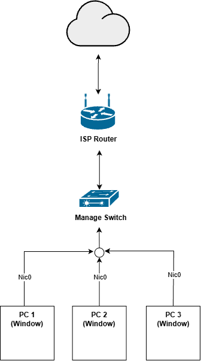
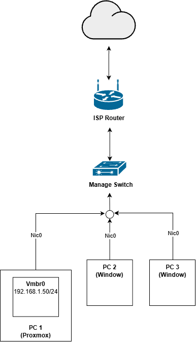

# 2026-11-05 — ติดตั้ง Proxmox แทน Windows

## ก่อนเริ่ม

เนื่องจากช่วงนี้เป็นช่วงปิดเทอมประมาณ 2-3 อาทิตย์ ก่อนที่จะไปฝึกงานตำแหน่ง Network Engineer ผมเลยอยากจะหาอะไรทำ เลยถือโอกาสมาทำ Homelab เลยดีกว่า แต่ถ้าจะให้ซื้ออุปกรณ์ Server แยกสำหรับแต่ละ Service ก็คงเปลืองไปหน่อย ไหนๆ ก็มี PC ที่ไม่ได้ใช้อยู่แล้ว ก็เอามาทำเป็น Server ของ Lab นี้เลยแล้วกัน ในช่วงไม่นานมานี้ได้มารู้จัก Proxmox และใช้ทำ Project ด้วย เลยได้คลุกคลีอยู่กับมันมาบ้าง เลยตัดสินใจติดตั้ง Proxmox แทน Windows ของ PC เครื่องนี้เลย แต่ปัญหาคือผมไม่เคยลง OS เลยนี่สิ ปกติจะให้ที่ร้านคอมลงให้ตลอด แต่ครั้งนี้คงช่วยไม่ได้ ยังไงถ้าไม่ลองก็คงไม่เป็น

## สิ่งที่ทำ

1. ดาวน์โหลดไฟล์ `.iso` ของ Proxmox มา หลังจากนั้นใช้ balenaEtcher / Rufus เขียน image file นั้นลงแฟลชไดรฟ์

2. ทำให้ PC boot Proxmox OS แทนที่จะเป็น Windows บน SSD โดยต้องปิดเครื่องและเปิดใหม่เพื่อเข้าหน้า BIOS ของคอม — ถ้าจำไม่ผิดต้องกด Del แต่กว่าจะรู้ว่าควรเริ่มกดตั้งแต่ตอนไหน ก็เปิดปิดไปหลายรอบมาก

3. หลังจากเข้าหน้า BIOS มาได้ ต้องมาปรับ Boot Order ให้ใช้จากแฟลชไดรฟ์แทน แต่ปัญหาคือตอนแรกไม่มีแฟลชไดรฟ์ให้เลือกด้วยซ้ำ ทั้งๆ ที่มั่นใจว่าเสียบแฟลชไดรฟ์กับแฟลช image ลงแล้ว ตอนแรกนึกว่าเป็นปัญหาของ software ที่ใช้แฟลช เลยเปลี่ยนจาก Rufus เป็น balenaEtcher แต่ผลก็ยังเหมือนเดิม

4. ตั้งค่าบางอย่างบน BIOS ซึ่งผมก็จำไม่ได้แล้วว่าตั้งอะไรไปบ้าง แต่ในที่สุดก็สามารถ boot จากแฟลชไดรฟ์ได้แล้ว

5. Proxmox ขึ้นให้เลือกว่าจะติดตั้งผ่าน GUI หรือ Terminal แต่หลังจากเลือกอย่างใดอย่างหนึ่งแล้ว ขึ้นข้อความว่า
   น่าจะเกี่ยวกับการ์ดจอ Nvidia ที่ใช้อยู่ ต้องติดตั้งแบบ `nomodeset` ถึงจะไม่ขึ้น error ดังกล่าว

6. ในตอนแรกเลือกติดตั้งแบบ Terminal จนเสร็จเรียบร้อย แต่ภาพที่แสดงบนหน้าจอเป็นแค่ CLI ไม่มี Web GUI ใดๆ เลย ตอนนั้นคิดว่าเกิดจากการเลือกติดตั้งแบบ Terminal (ซึ่งก็มารู้ทีหลังว่ามันไม่เกี่ยว 😅) จึงเริ่มทำใหม่ตั้งแต่แรก boot ใหม่จากแฟลชไดรฟ์แล้วเลือกติดตั้งแบบ GUI แต่พบว่าภาพ GUI สำหรับติดตั้งที่แสดงบนหน้าจอมัน zoom หนักมาก แทบมองไม่เห็นเลย น่าจะมาจาก monitor ที่ใช้อยู่ ซึ่งผมก็พยายามกดปุ่มบน monitor เพื่อปรับ resolution แต่ก็ไม่สามารถปรับได้ ตอนแรกก็พยายามใช้จิตสัมผัสกดปุ่มบนคีย์บอร์ดอย่างเดียวโดยที่แทบไม่เห็นอะไรเลย หน้าแรกๆ ที่เป็น dropdown ก็พอถูไถได้ แต่ก็ยอมแพ้พอต้องเป็นช่องที่ต้องกรอกข้อมูล จึงย้ายกลับไปติดตั้งแบบ Terminal ซึ่งเป็นจังหวะที่เริ่มเอะใจว่าที่ติดตั้งด้วย Terminal รอบแรกนั้นน่าจะเสร็จแล้ว แต่ลืมไปว่าเราต้องเข้า Web GUI ผ่าน browser จากคอมเครื่องอื่น ซึ่งพอมารอบนี้ก็สำเร็จได้อย่างไม่มีปัญหา

