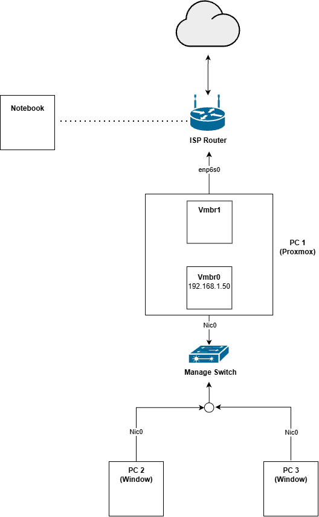
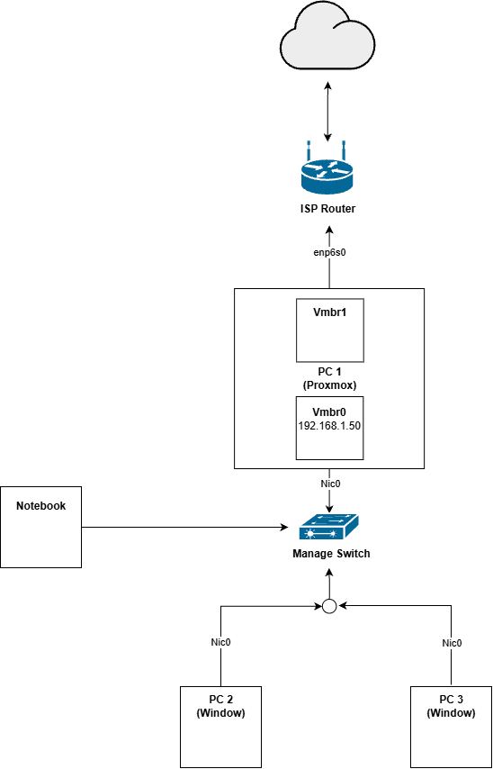
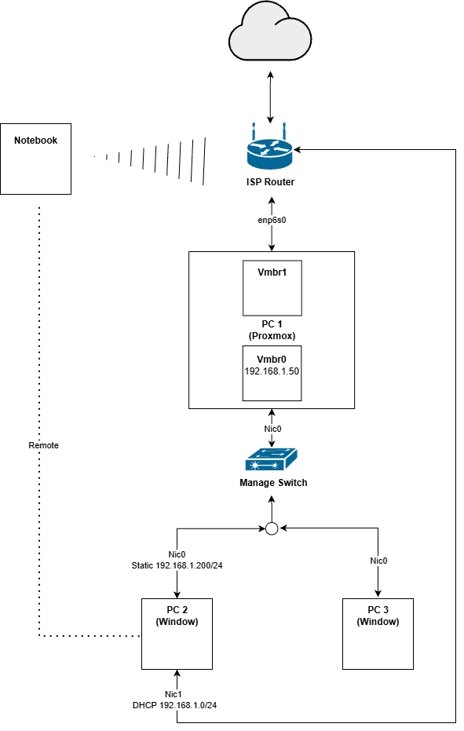
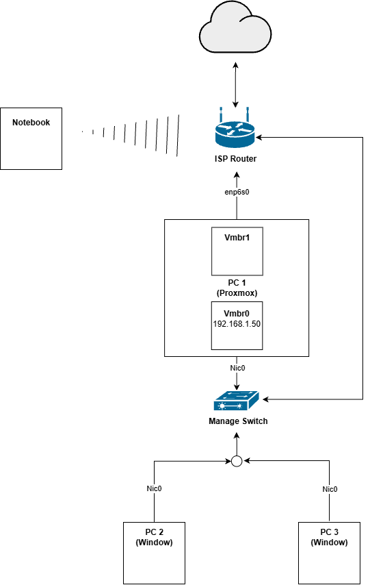

# 2026-11-02 — แก้ปัญหาการเชื่อมต่อ Proxmox Web UI

> **สรุป:** Notebook เข้า Proxmox Web UI ที่ `192.168.1.50:8006` ไม่ได้ เพราะ IP ของ Host อยู่บน `vmbr0` / `nic0` ซึ่งยังไม่มีทางออกไปหา Gateway

| สถานะ | เทคโนโลยี | ตอนก่อนหน้า |
|---|---|---|
| ✅ สำเร็จ | Proxmox VE, vmbr0, DHCP, Static IP, Layer 2 | [← ติดตั้ง Proxmox แทน Windows](2026-11-1-Proxmox.md) |

---

## สถานะปัจจุบัน

ตอนนี้ยังไม่มี firewall เป็นตัวเชื่อมทั้ง vmbr 0 , vmbr 1 และ notebook ต่อเน็ตผ่าน wifi

  
  
<em>Topology ตอนที่ Notebook เข้า Proxmox UI ไม่ได้</em>

## ปัญหาที่เจอ

เชื่อม proxmox ui ผ่าน ip 192.168.1.50 ไม่ได้ เพราะ ip ของ host proxmox ตอนนี้ถูกอยู่กับ vmbr0 หรือ nic0 ที่ไม่สามารถติดต่อ gateway ของตัวได้ด้วยซ้ำ

## การวิเคราะห์และทดลอง

### 1. PC1-4 เชื่อมต่อได้ เพราะอยู่ Subnet เดียวกัน

แต่อุปกรณ PC1-4 สามารถ เชื่อมต่อกับ proxhost ผ่าน ip 192.168.1.50 ได้ เพราะอยู่บน subnet เดียวกัน คุยกันระดับ layer 2 โดยที่ไม่จำเป็นต้อง route ผ่าน router ด้วยซ้ำ

### 2. Notebook ต่อสาย Ethernet เข้า Switch

และหาก notebook ต่อสาย ethernet กับ switch ก็สามารถเชื่อมต่อกับ proxmox ได้เช่นกัน มีแนวคิดเดียวกับที่กล่าวไปก่อนหน้า

  
  
<em>Topology เมื่อต่อ Notebook เข้า Switch</em>

### 3. PC4 (2 NIC) ต้องตั้ง Static IP

ตอนที่จะทดลองว่า pc1-4 สามารถเชื่อมต่อหา proxmox host ได้มั้ย มีปัญหาคื่อ pc พวกนี้ไม่ได้ต่ออุปกรณ์อะไรเลยยกเว้นสายเน็ต แล้วควบคุมผ่าน remote อีกทีนึง แต่พอมาสถานการณ์นี้ที่ pc ออกเน็ตไม่ได้ แต่โชคดีที่ pc4 มี 2 nic เลยใช้อีกสายนึง ต่อ router เพื่อออกเน็ตและ remote เข้ามา

แต่จะเชื่อม 192.168.1.50:8006 ดันเข้า ui ไม่ได้ ก็พบว่า nic ที่ต่อกับ switch เดิมรับ ip ผ่าน dhcp แล้ว interface นี้ต่อ dhcp server ไม่ได้ (router) จึงทำให้ไม่มี ip แล้วเวลาเชื่อมต่อไปหา 192.168.1.50 จึงคาดว่าน่าจะส่งออกไปแค่ interface ที่ต่อกับ router เท่านั้น เพราะพฤติกรรมตามปกติเวลาส่ง packet ออกจะตรวจจาก subnet interface นั้น กับ ปลายทางว่าอยู่บน broadcast domain เดียวกันมั้ย ดังนั้น interface ที่ไม่มี ip จึงไม่มี packet ส่งออก และทำให้ต่อ proxmox host ไม่ได้

เลยตั้ง static ip ชั่วคราวให้ interface นั้น และตามคาด รอบนี้สามารถเชื่อมต่อ proxmox host ได้แล้ว

  
  
<em>Topology ของ PC4 ที่มี 2 NIC และตั้ง Static IP</em>

### 4. อีกวิธี: ต่อสายระหว่าง Router กับ Switch

อีกวิธีนึงคือ ต่อสาย ethernet ระหว่าง router , switch ในขณะที่ notebook ยังต่อเน็ตด้วย wifi เท่านี้ router ก็สามารถ forward การเชื่อมต่อไปหา proxmox host 192.168.1.50 ได้เหมือนกัน

  
  
<em>Topology เมื่อต่อสายระหว่าง Router กับ Switch</em>

## สรุปวิธีเชื่อมต่อ Proxmox Web UI

| วิธี | หลักการ | ผลลัพธ์ |
|---|---|---|
| PC1-4 เชื่อมผ่าน Switch | อยู่ Subnet เดียวกัน คุยกันที่ Layer 2 ไม่ต้อง route ผ่าน Router | ✅ เชื่อมต่อได้ |
| Notebook ต่อสาย Ethernet เข้า Switch | แนวคิดเดียวกับ PC1-4 | ✅ เชื่อมต่อได้ |
| ตั้ง Static IP ให้ NIC ที่ต่อกับ Switch (PC4) | NIC ที่ไม่มี IP จะไม่ส่ง packet ออก | ✅ เชื่อมต่อได้ |
| ต่อสาย Ethernet ระหว่าง Router กับ Switch | Router forward การเชื่อมต่อไปหา `192.168.1.50` ให้ | ✅ เชื่อมต่อได้ |

---

[🏠 หน้าหลัก](../README.md) · [← ตอนก่อนหน้า](2026-11-1-Proxmox.md)

