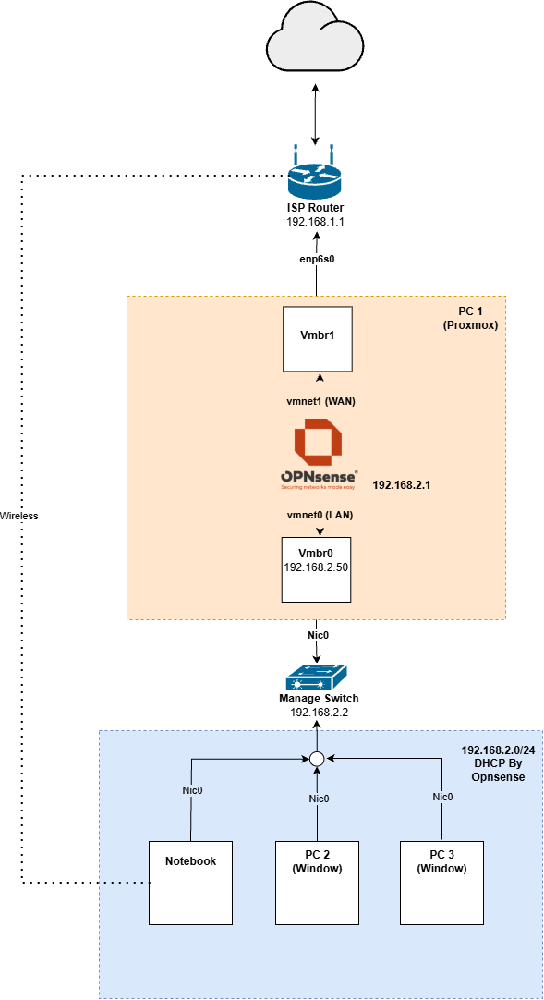

# 2026-11-03 — ติดตั้ง OPNsense และแยกฝั่ง LAN เป็น 192.168.2.0/24

> **สรุป:** ติดตั้ง OPNsense บน Proxmox แล้วแยกฝั่ง LAN ไปใช้ `192.168.2.0/24` จน Notebook และ PC ฝั่ง LAN ออกเน็ตได้โดยไม่ต้องต่อ Wi-Fi

| สถานะ | เทคโนโลยี | ตอนก่อนหน้า |
|---|---|---|
| ✅ สำเร็จ | OPNsense, Proxmox VE, SeaBIOS, DHCP, NAT | [← เพิ่ม NIC แล้ว Map เข้ากับ vmbr1](2026-11-2-Proxmox.md) |

---

## ติดตั้ง OPNsense

วันนี้ผมเริ่มติดตั้ง OPNsense เนื่องจากว่าผมเคยลงมาแล้วรอบนึง จึงค่อนข้างราบรื่น ตั้งแต่ Download ISO file สร้าง VM

### 1. Boot จาก ISO file ไม่ได้

แต่ติดปัญหาอย่างนึงที่ไม่สามารถ Boot จาก ISO file นั้นได้ ตอนแรกผมก็งง เพราะไม่เคยเจอแบบนี้มาก่อน แต่มาพบว่าปัญหาเกิดจากประเภทของ BIOS ตอนแรกผมตั้งเป็น UEFI เหมือนว่าตัวมันจะมีระบบ Secure Boot ป้องกันไม่ให้เรา Boot Image File ที่ไม่ได้อยู่ใน List จึงเปลี่ยนเป็น SeaBIOS ที่เก่ากว่า และไม่มี Secure Boot และก็สามารถ Boot ได้ตามปกติ

### 2. ตั้งค่า Interface

หลังจากนั้นก็ตั้งค่า Interface ของ OPNsense เอง ซึ่งเราต้อง Map ระหว่าง Interface ของ OPNsense (`vtnet0`, `vtnet1`) กับ Bridge ของ Proxmox (`vmbr0`, `vmbr1`) ซึ่งในขั้นตอนตั้งค่า VM เราต้องเพิ่ม Network Device ที่ต่อเข้ากับ `vmbr0`, `vmbr1` ให้ VM มันด้วย ซึ่งผม Map ทั้ง 2 คู่นี้ตามเลขมันเลย เช่น `vmbr0` กับ `vtnet0` เพื่อให้จำง่ายๆ หลังจากนั้นในบริบทของ OPNsense เราก็จะใช้ vtnet แทน

นอกจากนั้น `vtnet0` ทำหน้าที่เป็น LAN ให้เป็น Interface ที่ต่อในวง ส่วน `vtnet1` ให้ออกข้างนอก (ถึงจริงๆ แล้วมันก็ยังเป็นในบ้านผมก็เถอะ)

## เปลี่ยนวง IP ฝั่ง LAN

นอกจากนั้นเราก็ได้ IP ของ OPNsense ของทั้ง 2 Interface มา ซึ่งในตอนแรกเลย ผมคิดว่าทั้งฝั่ง WAN และ LAN จะใช้ IP ช่วง `192.168.1.0/24` ได้เหมือนเดิม เพราะผมคิดว่า Firewall แค่เอามาคั่นกลาง แล้วส่งต่ออะไรแบบนั้น IP ของ OPNsense ทั้ง 2 Interface ยังเป็น `192.168.1.51` และ `192.168.1.52` อยู่เลย

น่าจะเพราะว่าผมยังไม่ได้มีคอนเซปต์เรื่อง Gateway, NAT อะไรขนาดนั้น อย่างมาก NAT ก็ Map ระหว่าง private IP และ public IP (WAN) ซึ่งฝั่ง public มันก็เป็นด้านนอกแล้ว ซึ่งพอคิดว่ามันออกนอก Network เราแล้วก็เลยไม่ได้ใส่ใจ ซึ่งต่างจากตอนนี้ ที่ฝั่ง WAN มันยังอยู่ใน Network ของผมอยู่

จนผมมารู้คอนเซปต์เรื่องการ NAT ผมตัดสินใจเปลี่ยนให้ฝั่ง LAN ใช้ IP ช่วง `192.168.2.0/24` แทน ส่วนฝั่ง WAN ใช้ `192.168.1.0/24` ผมเลือกจะเปลี่ยนฝั่ง LAN แทนเพราะไม่อยากให้ Homelab มันไปกระทบอะไรกับของเดิมจาก ISP เดี๋ยวพ่อแม่ผมจะเล่นเน็ตไม่ได้เอา 55555

พอคิดอย่างนั้นก็เลยให้ OPNsense ทำหน้าที่เป็น DHCP Server แจก IP ให้ฝั่ง LAN ช่วง `192.168.2.100` - `192.168.2.200` เน้นช่วงแรกเอาไว้ เผื่อได้สำหรับ Server, Service ในอนาคตใช้ จะได้แยกง่ายๆ

## ปัญหาที่เจอ: เข้า Web GUI ของ Proxmox ไม่ได้

พอแก้ IP ของ Host เรียบร้อย ผมก็ต้องมาเก็บงานเปลี่ยน IP ของ Proxmox Host ฝั่ง LAN ด้วย เป็น `192.168.2.50` จาก `192.168.1.50` แต่พอเปลี่ยนแล้ว ผมดันเข้า Web GUI ด้วย IP ใหม่ไม่ได้ แถมผมไม่มี IP Proxmox Host สำรองที่ฝั่ง WAN ด้วย

### 1. ไล่ระดับ Network

ตอนนั้นพยายามทำหลายอย่างมาก ลอง Ping หาก็ไม่ได้, ARP หาก็ไม่ตอบ, ผมเอาสาย LAN ที่ต่อระหว่าง ISP Router กับ Managed Switch ออก ตอนนั้นคิดว่าตัดปัจจัยอื่นทิ้งให้หมดเอา Layer 3 ออกไปเลย ผมไม่ต่อ Wi-Fi ใช้สาย LAN ต่อกับ Switch เท่านั้น

แต่มีจุดแปลกอย่างที่ 1 คือผมไม่ได้ IP จาก DHCP Server ที่ตั้ง ทั้งๆ ที่ก่อนหน้านี้ได้ (ช่วงก่อนเปลี่ยน IP Host Proxmox) เลยต้องตั้ง IP Interface นั้นเป็น Static เองก่อน ซึ่งจนถึงตอนนี้ก็ยังเข้า Web Proxmox ไม่ได้อยู่ดี

ผมไปตรวจ Config Switch ว่าทุก Port เป็น VLAN เดียวกันมั้ย ก็ใช่ Default มันเป็น 1 อยู่แล้ว ลองเปลี่ยนเฉพาะ Notebook กับ Port ที่ต่อกับ `nic0` ของ PC1 เป็น 2 ก็ยังไม่ได้ ซึ่งผลมันไม่ต่างกันหรอก แต่ตอนนั้นผมคิดว่าผมเปลี่ยนเลข 1 ใน IP เป็น 2 ใน Octet ที่ 3 บางทีอาจเกี่ยวกัน ซึ่งไม่เกี่ยวเลย มันเป็นแค่วิธีตั้งให้อ่านง่ายๆ เฉยๆ

หลังจากนั้น ผมเอาสาย LAN ต่อตรงระหว่าง Notebook กับ PC1 ก็แล้วก็ยังไม่ได้

### 2. ต่อจอเข้า PC1 แต่ขึ้น No Signal

พอไล่ระดับ Network จนท้อแล้ว เลยลองต่อจอกับ PC1 ผ่านการ์ดจอด้วยสาย HDMI หวังจะแก้ IP ให้กลับมาเป็นเหมือนเดิม แต่พอต่อแล้วจอดันขึ้น No Signal อีก ลองรีคอม เปลี่ยนจอ เปลี่ยนสาย หลายรอบมาก ก็ยังไม่ได้

จนมาคิดว่ามันเพราะ Proxmox มันไม่ส่งภาพออกทางการ์ดจอรึเปล่า แต่ก็มารู้ทีหลังว่าไม่ใช่ ถึงไม่รู้ทฤษฎีรองรับแต่ตอนที่เพิ่งลง Proxmox เสร็จ ผมจำได้ว่าภาพมันออกแน่ๆ ตอนนั้นสิ้นหวังสุดๆ จะมา Config ตรงก็ไม่ได้ แม้แต่จะเข้า BIOS มาลง Proxmox ใหม่ยังไม่ได้เลย

### 3. ต้นเหตุอยู่ที่ RAM

จนผ่านมาซักพักมาสังเกตว่าไฟตรง Port Ethernet มันไม่กระพริบ ซึ่งเป็นจุดแปลกอย่างที่ 2 จึงเริ่มสังหรณ์ว่าหรือปัญหามันอยู่ที่คอม แล้วเห็นรหัส `bA` บน LED ที่ Mainboard พอหาง่ายๆ บน Google ได้ความว่าเกี่ยวกับ RAM ซึ่งคอมเครื่องนี้เป็น RAM 32 2 ตัว ผมลองถอดตัวที่อยู่ตำแหน่งถอดง่ายกว่าออกมาก่อนเหลือไว้ 1 ตัว แล้วลองเปิดใหม่ แล้วภาพก็ส่งออกจอได้แล้ว แถมเข้า Web GUI ได้แล้วด้วย (ตอนนั้นต่อสายตรงที่ Port Ethernet เลย)

พอเจอปัญหาแล้วก็เอายางลบมาถูๆ กับ RAM ที่เอาออกมาแล้วใส่กลับไปใหม่ คราวนี้ใช้ได้ตามปกติ กลับมาต่อสายเหมือนเดิม

## ปัญหาที่เจอ: ฝั่ง LAN ออกเน็ตไม่ได้

แต่ปัญหาก็ยังไม่หมด ตอนนี้ฝั่ง LAN มันยังไม่สามารถออกเน็ตได้ ซึ่งมันน่าจะเกี่ยวกับการ NAT ตอนแรกผมก็ลองพยายามตั้ง Static NAT ให้มัน Map IP จาก LAN ไป WAN แต่สุดท้ายก็ยังไม่ได้

จนมารู้ตัวว่า ตัวเองเผลอเอา Gateway ของ Interface WAN ออก ซึ่งเป็นตัวที่ทำให้ OPNsense รู้เส้นทางออกและทำ NAT ระหว่าง 2 Interface นี้ และมันก็เป็น Default ของมันอยู่แล้วด้วย แต่ผมไปเอาออกเพราะนึกว่ามันเกี่ยวกับ Firewall พอตั้งกลับมา ตอนนี้ทั้ง Notebook และ PC ฝั่ง LAN ก็สามารถออกเน็ตได้โดยไม่ต้องต่อ Wi-Fi แล้ว

  
  
<em>Topology หลังติดตั้ง OPNsense</em>

## สรุปปัญหาที่เจอ

| ปัญหา | สาเหตุ | วิธีแก้ |
|---|---|---|
| Boot จาก ISO file ไม่ได้ | ตั้ง BIOS เป็น UEFI ซึ่งเหมือนว่าจะมี Secure Boot | เปลี่ยนเป็น SeaBIOS |
| คิดว่า WAN และ LAN ใช้ `192.168.1.0/24` ได้เหมือนเดิม | ยังไม่มีคอนเซปต์เรื่อง Gateway, NAT | เปลี่ยนฝั่ง LAN เป็น `192.168.2.0/24` |
| เข้า Web GUI ด้วย IP ใหม่ไม่ได้ และจอขึ้น No Signal | RAM (รหัส `bA` บน LED ที่ Mainboard) | ถอด RAM ออกมาถูด้วยยางลบแล้วใส่กลับ |
| ฝั่ง LAN ออกเน็ตไม่ได้ | เผลอเอา Gateway ของ Interface WAN ออก | ตั้ง Gateway ของ Interface WAN กลับมา |

---

[🏠 หน้าหลัก](../README.md) · [← ตอนก่อนหน้า](2026-11-2-Proxmox.md) · [ตอนถัดไป →](2026-11-5-Hermes.md)

