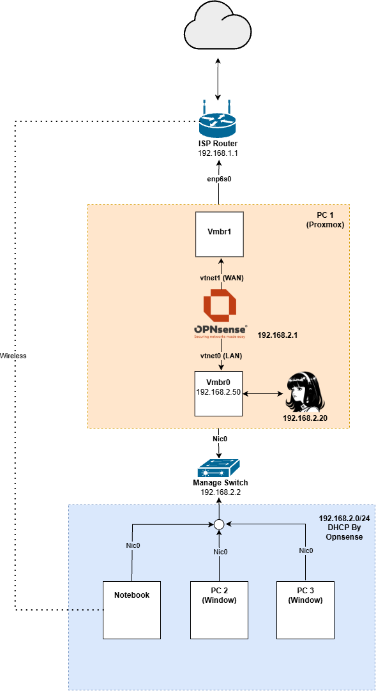

# 2026-11-05 — ลง Hermes Agent บน Proxmox (LXC + Docker)

> **สรุป:** ติดตั้ง Hermes Agent เป็น LXC บน Proxmox ที่ `192.168.2.20` แล้วรัน Hermes Agent ซ้อนใน Docker อีกชั้น เปิด Dashboard ได้สำเร็จด้วย Local Auth แต่ของที่ลองต่อเพิ่มระหว่างทางยังเชื่อม Backend ไม่ได้

| สถานะ | เทคโนโลยี | ตอนก่อนหน้า |
|---|---|---|
| ✅ สำเร็จ | Proxmox VE, LXC, Docker, Docker Compose, Hermes Agent | [← ติดตั้ง OPNsense และแยกฝั่ง LAN เป็น 192.168.2.0/24](2026-11-3-OPNsense.md) |

---

## ช่วงนี้ไม่ได้เขียน Journal

โอเค ช่วงนี้ผมไม่ได้เขียนลืมเขียน Journal เลย เอาจริงก็แอบขี้เกียจด้วย ช่วงนี้ทำอะไรไปหลายอย่างเลย เดี๋ยวจะค่อยๆ ไล่ Timeline นะครับ

## ติดตั้ง Hermes Agent บน Proxmox

อย่างแรกผมได้ลง Hermes Agent Server บน Proxmox เรียบร้อยแล้ว อยู่บน `vmbr0` IP `192.168.2.20` แบบ LXC ไม่ใช่ VM เพราะมันกินทรัพยากรน้อยกว่า เท่าที่เข้าใจเพราะว่า LXC นี้ใช้ทรัพยากรบางอย่างรวมกันกับ Proxmox Host เพราะว่าทั้งคู่เป็น Linux เหมือนกัน ถึงจะต่าง Distro กัน (ผมยังไม่ชัวร์เรื่องนี้ เดี๋ยวไว้หาข้อมูลเพิ่ม) แล้วก็ลง Hermes Agent ไว้บน Docker Container อีกทีนึง ทำให้ Hermes โดนหุ้มหลายชั้นเลย 555555

เอ้อ จริงด้วย เหตุผลหลักอย่างหนึ่งที่ผมมาทำ Homelab ก็เพราะอยากลองใช้ Hermes ด้วย แต่ตามคลิปใน YouTube เขาจะลงกันบน VPS แต่ผมมีคอมที่บ้านอยู่แล้วก็เลยใช้เป็น Server ของ Hermes เองเลย

## ปัญหาที่เจอ: ไม่มีพื้นฐาน Docker

ในระหว่างทางที่ติดตั้งก็เจอปัญหาหลายอย่าง แต่ส่วนใหญ่ก็มาจากการที่ไม่รู้จักเครื่องมือ ทำให้ต้องใช้เวลานานด้วย เช่น ผมไม่ค่อยมีพื้นฐาน Docker เท่าไร ถึงจะเคยใช้บ้าง แต่มันก็เว้นช่วงเกินไปจนทำให้ลืมทุกครั้งที่มาใช้ใหม่

แต่ระหว่างช่วงที่ทำรอบนี้ ถึงแม้ผมจะขอคำแนะนำจาก AI ในการทำ แต่ผมก็พยายามทำความเข้าใจด้วย เพราะผมอยากเข้าใจในสิ่งที่ผมทำมากกว่าเอางานมาโชว์เฉยๆ

## สร้าง Container ด้วย `docker run`

ในตอนแรกผมสร้าง Container ด้วยคำสั่ง `docker run` และใส่ Parameter ต่างๆ ลงไป เช่น

1. **การ Mount File ระหว่าง Container กับ Host** — เวลาที่ผมสร้าง Container ใหม่ผมจะได้ใช้ข้อมูลเก่าได้ ซึ่งอันนี้ช่วยผมได้มากเลย เพราะผมลองผิดลองถูกอยู่หลายครั้งและต้องสร้าง Container ใหม่เรื่อยๆ
2. **Map Port ระหว่าง Host กับ Container** — ใช้ Port `8642` และ `9119` เป็น Backend และ Dashboard ตามลำดับ เท่าที่ผมเข้าใจ
3. **ตั้งค่า Environment ให้อนุญาตการใช้ Dashboard** — อันนี้มารู้ทีหลัง ซึ่งจะโยงไปถึงปัญหาต่อไป

## ปัญหาที่เจอ: เข้า Dashboard ผ่าน Port 9119 ไม่ได้

ปัญหาต่อมาเลยก็คือ ผมไม่สามารถเข้า Dashboard ของ Hermes ผ่าน Port `9119` ได้ ซึ่งสาเหตุมาจาก Environment ที่กล่าวถึงก่อนหน้านี้ กับผมยังไม่ได้ตั้งค่าการยืนยันตัวตนของ Dashboard

มันจะมี 2 วิธี คือแบบ Local ที่เราตั้ง Credential บน Config เอง แล้วก็เอามาใช้ Login ได้เลย ซึ่ง Password ใน Config จะเก็บแบบ Hash เพราะงั้นผมต้อง Hash Password ที่ผมจะใช้แล้วก็เอาใส่ในไฟล์ ส่วน Username เป็น Plain Text ได้เลย พอเสร็จเรียบร้อยผมก็สามารถเข้าหน้า Dashboard ได้เรียบร้อยแล้ว เย่ะ

## ระหว่างทาง: ไปเจอโปรเจกต์อื่นแล้วอยากลอง

แต่หลังจากนั้นกิเลสก็เริ่มมา ผมไปเจอ Git นึงชื่อ Hermes Studio มาพร้อม Feature ใหม่จำนวนมาก ที่ผมก็ไม่รู้ว่ามันคืออะไร แต่ด้วยนิสัยที่จะเรียกว่านิสัยเสียของผมก็ได้มั้ง ผมก็อยากลงขึ้นมา ซึ่งเอาจริงๆ ผมควรลองใช้ของเก่าที่มีอยู่ก่อน แล้วถ้าขาดจึงค่อยหา Solution แต่ไม่ทันละ ตอนนั้นผมก็พยายามติดตั้งเลย ซึ่งสุดท้ายก็ไม่สำเร็จ

เริ่มจากผม Clone Project ลงมาก่อน จากนั้นต้อง Build Container จากไฟล์ Docker Compose ซึ่ง ณ ตอนนั้นผม Build Container ด้วย `docker run` จึงต้องมาหัดใช้ แต่เมื่อผมดูไฟล์ Docker Compose ใน Project เขา พบว่า Service หลักๆ มี 2 ตัว คือ

- **Hermes Agent** — ตัวเดียวกับที่ผมลงเลย แต่ต่างกันที่ Properties ข้างในนิดหน่อย ที่เปิดแค่ Port `8642` สำหรับ Backend (เพื่อใช้ Dashboard จาก Hermes Studio แทน)
- **Hermes Studio** — ต่างจากเดิมตรงที่มันจะ Build Image ขึ้นมาจากไฟล์ใน Project ก่อนถึงจะสร้างเป็น Container

ด้วยความนึกสนุกอะไรผมซักอย่าง ผมอยากลองใช้ Docker มากกว่านี้ แทนที่ผมจะลบ Hermes Agent อันเก่าแล้วใช้ตาม Docker Compose อันนี้ ผมก็เลือกที่จะแก้ Properties ของ Hermes Agent ในไฟล์ให้ตรงกับ Parameter ที่ผมใช้ตอน `docker run` แทน ซึ่งผลก็ออกมาด้วยดี ติดแค่ตรง Dependency ใน `package.json` มี Dependency ไม่ครบ ผมก็ต้องไปเพิ่มนิดหน่อย

พอเสร็จผมก็ลองเข้า Dashboard อันใหม่ผ่าน Port `3000` แต่มีปัญหาว่าไม่สามารถติดต่อ Backend ได้ ซึ่งผมก็พยายามลองหาคำสั่งเพื่อเปิด, รีสตาร์ท Gateway แล้วแต่ก็ยังเชื่อมไม่ได้ สุดท้ายผมก็ยอมแพ้ไป ใช้เท่าที่มีไปก่อน 555555

## Hermes Desktop

หลังจากนั้นผมก็ Download Hermes Desktop บนโน้ตบุ๊ก เพื่อมาเชื่อมกับ Hermes Backend ที่ทำไว้ แต่มารู้ว่ามันสามารถใช้ Local เป็น Backend ได้ แถมด้วยการกดคลิกเดียว โอโห อิจฉาจริง ทำไมสบายอย่างนี้วะะ

  
  
<em>Topology หลังติดตั้ง Hermes Agent บน Proxmox</em>

## สรุปปัญหาที่เจอ

| ปัญหา | สาเหตุ | วิธีแก้ |
|---|---|---|
| ไม่มีพื้นฐาน Docker ต้องใช้เวลานานในการติดตั้ง | เคยใช้ Docker แต่เว้นช่วงนานจนลืม | ใช้ AI แนะนำพร้อมพยายามทำความเข้าใจไปด้วย |
| เข้า Dashboard ผ่าน Port `9119` ไม่ได้ | ยังไม่ได้ตั้งค่า Environment ให้อนุญาต Dashboard และยังไม่ได้ตั้งค่าการยืนยันตัวตน | ตั้ง Local Auth ด้วย Username (Plain Text) และ Password (Hash) ใน Config |
| Docker Compose build แล้ว Dependency ใน `package.json` ไม่ครบ | ไฟล์ใน Project ไม่ได้อยู่ในสภาพพร้อม build | เพิ่ม Dependency ที่ขาด |
| Dashboard ของโปรเจกต์ที่ลองลงเพิ่ม (Port `3000`) เชื่อม Backend ไม่ได้ | ยังไม่พบสาเหตุ ลองเปิดและรีสตาร์ท Gateway แล้วก็ยังไม่เชื่อม | ยังไม่ได้แก้ ใช้ Hermes Agent ตัวเดิมไปก่อน |

---

[🏠 หน้าหลัก](../README.md) · [← ตอนก่อนหน้า](2026-11-3-OPNsense.md)

