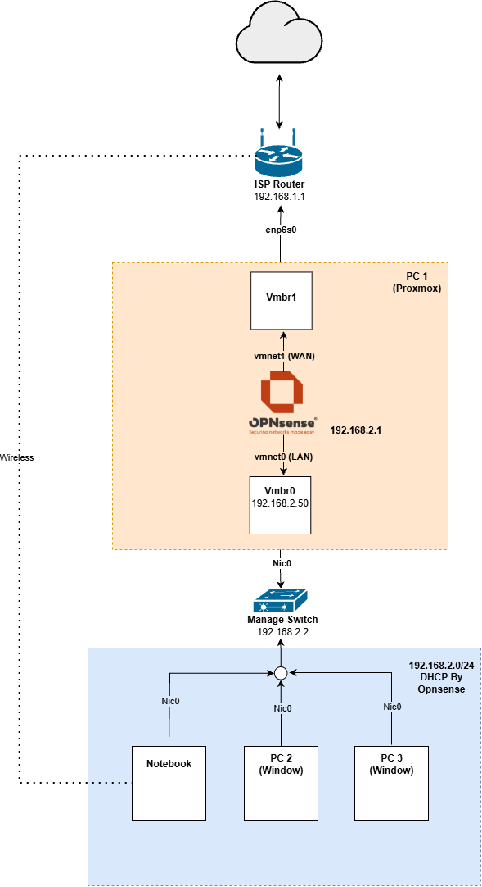

<div align="center">

# 🖥️ Homelab

บันทึกการสร้าง Homelab สำหรับฝึกทักษะด้าน Network และ Infrastructure จากอุปกรณ์ที่มีอยู่จริง


[Journal](#-journal) · [Topology](#-topology) · [Roadmap](#-roadmap) · [Diagrams](Diagrams/README.md)

</div>

---

## 📌 เกี่ยวกับ Project

Lab นี้เริ่มจากการนำ PC ที่ไม่ได้ใช้มาติดตั้ง Proxmox เพื่อเป็น Server กลาง แทนการซื้อ Server แยกสำหรับแต่ละ Service และใช้เป็นพื้นที่ฝึกก่อนเริ่มฝึกงานตำแหน่ง Network Engineer

ทุกขั้นตอนถูกบันทึกไว้ใน Journal ทั้งสิ่งที่ทำ ปัญหาที่เจอ และแนวคิดระหว่างแก้ปัญหา พร้อม Topology ของแต่ละช่วง

## 📓 Journal

| ตอน | หัวข้อ | สถานะ |
|---|---|---|
| [2026-11-1](Journal/2026-11-1-Proxmox.md) | ติดตั้ง Proxmox แทน Windows | ✅ สำเร็จ |
| [2026-11-2](Journal/2026-11-2-Proxmox.md) | เพิ่ม NIC แล้ว Map เข้ากับ vmbr1 | ✅ สำเร็จ |
| [2026-11-3](Journal/2026-11-3-OPNsense.md) | ติดตั้ง OPNsense และแยกฝั่ง LAN เป็น 192.168.2.0/24 | ✅ สำเร็จ |

## 🌐 Topology

<div align="center">
  
  <p><em>Topology จาก Journal ตอน 2026-11-3</em></p>
</div>

### อุปกรณ์ในแผนภาพ

| อุปกรณ์ | หน้าที่ | การเชื่อมต่อ |
|---|---|---|
| ISP Router | Gateway ออกอินเทอร์เน็ต (`192.168.1.1`) | Internet, PC 1 (`enp6s0`), Notebook (Wi-Fi) |
| OPNsense (VM บน PC 1) | Firewall, NAT และ DHCP Server ของฝั่ง LAN (`192.168.2.1`) | WAN (`vtnet1`) ไป `vmbr1`, LAN (`vtnet0`) ไป `vmbr0` |
| Managed Switch | เชื่อมอุปกรณ์ภายใน Lab (`192.168.2.2`) | PC 1 (`nic0`), PC 2, PC 3, Notebook |
| PC 1 | Proxmox Host (`192.168.2.50`) | `nic0` ไป Switch, `enp6s0` ไป Router |
| PC 2, PC 3 | เครื่อง Windows | `Nic0` ไป Switch |
| Notebook | ใช้ควบคุมและจัดการ Lab | `Nic0` ไป Switch, Wi-Fi ไป Router |

Topology ของช่วงอื่นดูได้ที่ [สารบัญ Diagrams](Diagrams/README.md)

## 🗺️ Roadmap

- [x] ติดตั้ง Proxmox แทน Windows
- [x] เชื่อมต่อ Proxmox Web UI
- [x] เพิ่ม Firewall (OPNsense) เป็นตัวเชื่อม `vmbr0` และ `vmbr1`

## 📂 โครงสร้าง Repository

```text
.
├── Journal/    # บันทึกแต่ละตอน ตั้งชื่อเป็น YYYY-MM-N-Topic.md
├── Diagrams/   # Topology ทั้งไฟล์ต้นฉบับ (.drawio) และไฟล์ส่งออก (.png)
└── README.md
```
